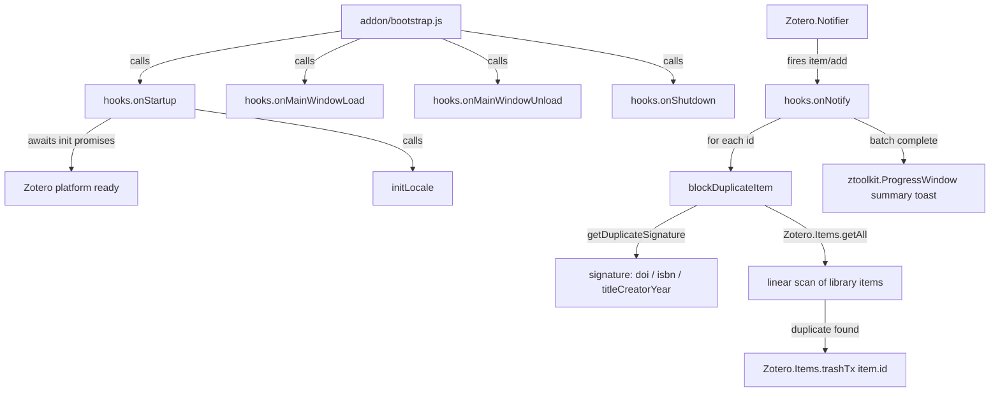
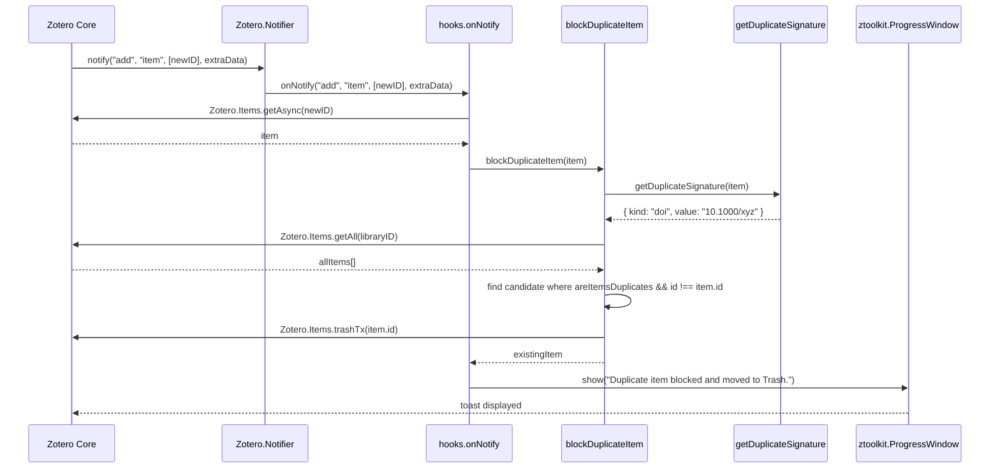
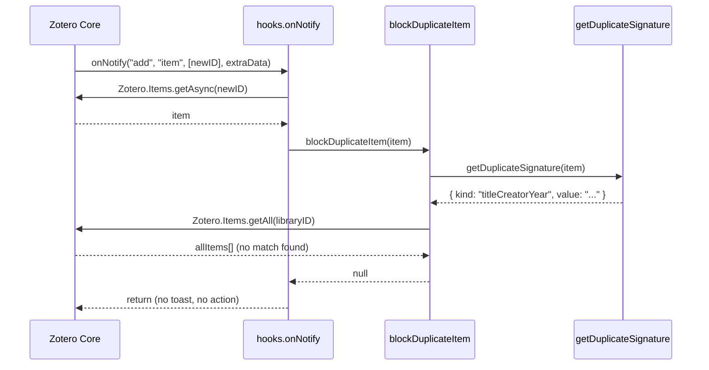

# Design Document: zotero-duplicate-import-blocker

## Overview

The `zotero-duplicate-import-blocker` plugin (package name: **No Duplicates**) silently intercepts every new item added to a Zotero library, checks whether an identical item already exists using a custom signature-based duplicate detection algorithm, and — if a duplicate is detected — moves the newly added item to the trash before the user ever sees it. A brief, non-intrusive progress-window toast informs the user how many items were blocked.

The plugin is built on the official [windingwind Zotero Plugin Template](https://github.com/windingwind/zotero-plugin-template). It wires into the template's established `hooks.ts` lifecycle pattern; all duplicate logic lives in pure exported functions in `noDuplicates.ts`.

---

## Architecture

### Overall plugin structure



### File layout

```
zotero-plugin-noduplicates/
├── package.json                     ← addonName/ID/Ref/Instance updated
├── src/
│   ├── index.ts                     ← unchanged (creates Addon singleton)
│   ├── addon.ts                     ← minimal (no prefs/dialog data)
│   ├── hooks.ts                     ← minimal: only NoDuplicates wiring
│   ├── modules/
│   │   └── noDuplicates.ts          ← pure exported functions
│   └── utils/
│       └── ztoolkit.ts              ← unchanged
└── .kiro/specs/zotero-duplicate-import-blocker/
    ├── .config.kiro
    └── design.md
```

---

## Sequence Diagrams

### Item-add happy path (duplicate detected)



### Item-add no-op path (no duplicate)



---

## Components and Interfaces

### `noDuplicates.ts` (`src/modules/noDuplicates.ts`)

**Purpose**: Houses all duplicate-blocking logic as pure exported functions. No class wrapper.

**Interface**:

```typescript
/** Extracts a comparable signature from an item.
 *  Priority order: DOI → ISBN → title+firstCreator+year.
 *  Returns null for non-regular items, feed items, or items with insufficient metadata. */
export function getDuplicateSignature(
  item: DuplicateComparableItem,
): DuplicateSignature | null;

/** Returns true when both items share the same signature kind and value. */
export function areItemsDuplicates(
  first: DuplicateComparableItem,
  second: DuplicateComparableItem,
): boolean;

/** Checks all items in the library for a duplicate of item.
 *  If a duplicate is found, moves item to trash via Zotero.Items.trashTx
 *  and returns the surviving (pre-existing) item.
 *  Returns null when no duplicate exists or item is ineligible. */
export async function blockDuplicateItem(
  item: Zotero.Item,
): Promise<Zotero.Item | null>;

// Normalisation helpers (also exported for testing):
export function normalizeDOI(value: string): string;
export function normalizeISBN(value: string): string;
export function extractYear(value: string): string;
```

**`DuplicateSignature` type**:

```typescript
interface DuplicateSignature {
  kind: "doi" | "isbn" | "titleCreatorYear";
  value: string;
}
```

**Signature extraction priority**:

| Priority | Field | Normalisation |
|---|---|---|
| 1 | DOI | lowercase, strip `https?://(dx.)doi.org/` prefix |
| 2 | ISBN | uppercase, strip non-`[0-9X]` chars, must be 10 or 13 digits |
| 3 | title + firstCreator + year | lowercase+trim, concatenated with `\|` separator |

For priority 3, at least one of `firstCreator` or `year` must be non-empty (title-only matches are too broad).

**Responsibilities**:
- Extracts a normalised, comparable signature for each eligible item
- Performs a linear scan of all library items to find a matching duplicate
- Moves the newly added item to trash using `Zotero.Items.trashTx`
- Returns the surviving duplicate item so the caller can report it

---

### `hooks.ts` (minimal)

**Responsibilities**:
- Awaits Zotero init promises in `onStartup`, calls `initLocale`, loads main windows
- `onMainWindowLoad` creates the ztoolkit instance
- `onNotify` filters for `event === "add" && type === "item"`, then loops over IDs calling `blockDuplicateItem` for each
- After the loop, shows a single summary toast if any items were blocked
- Notifier registration is handled by the template's `bootstrap.js`/`addon.hooks` wiring — no manual `registerNotifier` call needed

**`onNotify` logic**:

```typescript
async function onNotify(event, type, ids, extraData) {
  if (event !== "add" || type !== "item") return;

  let blockedCount = 0;
  for (const id of ids) {
    const item = await Zotero.Items.getAsync(id);
    const existingItem = await blockDuplicateItem(item);
    if (existingItem) blockedCount += 1;
  }

  if (blockedCount <= 0) return;

  const summary =
    blockedCount === 1
      ? "Duplicate item blocked and moved to Trash."
      : `${blockedCount} duplicate items blocked and moved to Trash.`;

  new ztoolkit.ProgressWindow(addon.data.config.addonName)
    .createLine({ text: summary, type: "default", progress: 100 })
    .show();
}
```

---

### `package.json` config block (updated values)

```json
"config": {
  "addonName": "No Duplicates",
  "addonID": "noduplicates@plugin.zotero",
  "addonRef": "noduplicates",
  "addonInstance": "NoDuplicates",
  "prefsPrefix": "extensions.zotero.noduplicates"
}
```

---

## Data Models

### `DuplicateSignature`

| Field | Type | Meaning |
|---|---|---|
| `kind` | `"doi" \| "isbn" \| "titleCreatorYear"` | Which field the signature is based on |
| `value` | `string` | Normalised, comparable value |

Two items are duplicates iff both their signatures are non-null, their `kind` values match, and their `value` strings match exactly.

### Eligibility filter

An item passes the eligibility filter when **all** of the following hold:

```typescript
item.isRegularItem()   // not a note or attachment
&& !item.isFeedItem    // not a feed item (RSS)
```

Items already in the trash still produce a signature — `blockDuplicateItem` itself does not short-circuit on `item.deleted`. The linear scan uses `areItemsDuplicates` which calls `getDuplicateSignature`, and feed items / non-regular items return `null` from that function.

---

## Algorithmic Pseudocode

### `getDuplicateSignature(item)`

```pascal
FUNCTION getDuplicateSignature(item)
  INPUT: item — DuplicateComparableItem
  OUTPUT: DuplicateSignature or NULL

  IF NOT item.isRegularItem() OR item.isFeedItem THEN
    RETURN NULL
  END IF

  doi ← normalizeDOI(item.getField("DOI"))
  IF doi IS NOT EMPTY THEN
    RETURN { kind: "doi", value: doi }
  END IF

  isbn ← normalizeISBN(item.getField("ISBN"))
  IF LENGTH(isbn) IS 10 OR 13 THEN
    RETURN { kind: "isbn", value: isbn }
  END IF

  title ← normalizeText(item.getField("title"))
  IF title IS EMPTY THEN
    RETURN NULL
  END IF

  creator ← normalizeText(item.firstCreator OR "")
  year ← extractYear(item.getField("date", true, true))

  IF creator IS EMPTY AND year IS EMPTY THEN
    RETURN NULL
  END IF

  RETURN { kind: "titleCreatorYear", value: title + "|" + creator + "|" + year }
END FUNCTION
```

---

### `blockDuplicateItem(item)`

```pascal
FUNCTION blockDuplicateItem(item)
  INPUT: item — Zotero.Item (the newly added item)
  OUTPUT: Zotero.Item (the surviving duplicate) or NULL

  itemSignature ← getDuplicateSignature(item)
  IF itemSignature IS NULL THEN
    RETURN NULL  // item is ineligible (note/attachment/feed/no metadata)
  END IF

  allLibraryItems ← AWAIT Zotero.Items.getAll(item.libraryID)

  duplicate ← FIRST candidate IN allLibraryItems WHERE
    candidate.id NOT EQUALS item.id
    AND areItemsDuplicates(item, candidate)

  IF duplicate IS NULL THEN
    RETURN NULL  // no match found — item is unique
  END IF

  AWAIT Zotero.Items.trashTx(item.id)
  RETURN duplicate
END FUNCTION
```

**Preconditions:**
- `item` is a valid Zotero item retrieved via `getAsync`
- `item.libraryID` is valid

**Postconditions:**
- If a duplicate was found: `item` is in the Zotero trash (via `trashTx`) and the duplicate is returned
- If no duplicate: `item` is unmodified and `null` is returned
- `trashTx` is a transactional trash operation (not permanent deletion)

---

### `onNotify` batch processing

```pascal
PROCEDURE onNotify(event, type, ids, extraData)
  IF event NOT EQUALS "add" OR type NOT EQUALS "item" THEN
    RETURN
  END IF

  blockedCount ← 0

  FOR EACH id IN ids DO
    item ← AWAIT Zotero.Items.getAsync(id)
    existingItem ← AWAIT blockDuplicateItem(item)
    IF existingItem IS NOT NULL THEN
      blockedCount ← blockedCount + 1
    END IF
  END FOR

  IF blockedCount <= 0 THEN
    RETURN
  END IF

  summary ← IF blockedCount EQUALS 1
    THEN "Duplicate item blocked and moved to Trash."
    ELSE blockedCount + " duplicate items blocked and moved to Trash."

  SHOW ProgressWindow(addonName).createLine(summary).show()
END PROCEDURE
```

**Postconditions:**
- For each duplicate found: the new item is trashed
- A single summary toast is shown once per batch (not once per duplicate)
- No toast is shown when no duplicates are found

---

## Error Handling

### Scenario 1: Item is a note, attachment, or feed item

**Condition**: Notifier fires for non-regular-item types (file attachments, notes, RSS entries).  
**Response**: `getDuplicateSignature` returns `null` → `blockDuplicateItem` returns `null`.  
**Recovery**: Item is untouched; no performance overhead from library scan.

---

### Scenario 2: Item has no usable metadata (no DOI, no ISBN, title-only)

**Condition**: Item has a title but no creator and no year.  
**Response**: `getDuplicateSignature` returns `null` (title-only is too broad for safe deduplication).  
**Recovery**: Item is left as-is; no false-positive blocking.

---

### Scenario 3: Item deleted between notifier fire and processing

**Condition**: Item is deleted externally between the notifier firing and `blockDuplicateItem` executing.  
**Response**: `Zotero.Items.getAsync` may return a deleted item; `getDuplicateSignature` still runs. The risk is low since `trashTx` on an already-deleted item is a no-op.  
**Recovery**: Safe no-op.

---

### Scenario 4: `Zotero.Items.trashTx` throws

**Condition**: Database write fails (e.g., library locked by sync).  
**Response**: Error propagates up from `blockDuplicateItem`; caught by the caller in `onNotify`'s for-loop.  
**Recovery**: Item remains un-trashed; `blockedCount` is not incremented; next item in batch is still processed.

---

### Scenario 5: Plugin is shutting down during item processing

**Condition**: `addon.data.alive` is `false` when notifier callback fires.  
**Response**: The notifier callback in `bootstrap.js` checks `addon.data.alive` and short-circuits.  
**Recovery**: Pending items are not processed; clean shutdown.

---

## Correctness Properties

The following properties must hold for all valid inputs:

1. **No data loss**: For any item moved to trash, `trashTx` places it in the Zotero trash. No item is permanently deleted.

2. **Idempotency of signature**: `getDuplicateSignature` is a pure function — for the same item fields, it always returns the same result.

3. **Non-interference with non-duplicates**: For any item `i` where no candidate with a matching signature exists in the library, `blockDuplicateItem(i)` returns `null` and `i` is not modified.

4. **At-most-one survivor per duplicate pair**: After `blockDuplicateItem` processes a new item that has a duplicate, the new item is trashed and the pre-existing item is returned as the survivor.

5. **No blocking of notes/attachments/feeds**: Items where `!item.isRegularItem() || item.isFeedItem` always return `null` from `getDuplicateSignature` and are never trashed.

6. **Single toast per batch**: `onNotify` accumulates a `blockedCount` and shows at most one `ProgressWindow` per notifier event, regardless of how many duplicates were in the batch.

7. **Signature kind consistency**: Two items are considered duplicates only when their signatures share the same `kind`. A DOI match is never conflated with an ISBN or title match.

---

## Testing Strategy

The project uses `zotero-plugin-scaffold` with mocha/chai for integration tests running against a real Zotero instance.

### Unit Testing Approach

Each exported function in `noDuplicates.ts` should have isolated tests:

- `normalizeDOI` — strips URL prefix, lowercases
- `normalizeISBN` — strips non-`[0-9X]` chars, uppercases
- `getDuplicateSignature` — correct kind selection, null for ineligible items
- `areItemsDuplicates` — returns true only when kind and value both match
- `blockDuplicateItem` — with mocked `Zotero.Items.getAll`/`trashTx`: no-duplicate path returns null, duplicate path trashes and returns survivor

### Property-Based Testing Approach

**Property Test Library**: mocha + chai (project's existing stack)

Key properties to verify:

```typescript
// Property 1: getDuplicateSignature returns null for non-regular items
for all items where !item.isRegularItem() || item.isFeedItem:
  getDuplicateSignature(item) returns null

// Property 2: areItemsDuplicates is symmetric
for all (a, b):
  areItemsDuplicates(a, b) === areItemsDuplicates(b, a)

// Property 3: areItemsDuplicates is reflexive for eligible items
for all items where getDuplicateSignature(item) !== null:
  areItemsDuplicates(item, item) === true

// Property 4: items with different signature kinds are never duplicates
for all (a, b) where sig(a).kind !== sig(b).kind:
  areItemsDuplicates(a, b) === false
```

### Integration Testing Approach

Tests run against a live Zotero instance using `zotero-plugin-scaffold`:

1. **Test: clean import** — import a unique item; verify it is NOT trashed
2. **Test: duplicate DOI import** — import an item with the same DOI as an existing item; verify the new item is trashed
3. **Test: duplicate ISBN import** — same as above for ISBN
4. **Test: duplicate title+creator+year import** — same for the fallback signature
5. **Test: bulk import with mixed items** — import 3 items (1 unique, 2 duplicates); verify only duplicates are trashed; verify single toast
6. **Test: note/attachment passthrough** — add a note/attachment; verify it is never trashed

---

## Performance Considerations

- `blockDuplicateItem` calls `Zotero.Items.getAll(libraryID)` for every new item added. For large libraries (> 10,000 items) this is a linear scan on every import. If this becomes a user-reported concern, a signature cache could be built on startup and kept in sync via the notifier.
- The notifier fires for every item add, including programmatic bulk imports. `onNotify` processes IDs sequentially with `await`; for large batches this serialises the scan. If needed, the loop could be parallelised with `Promise.all` (with care around write contention on `trashTx`).
- All operations are async and non-blocking; they do not freeze the Zotero UI.

---

## Security Considerations

- The plugin only reads item metadata and calls `Zotero.Items.trashTx`. It does not access the filesystem, network, or any external service.
- No user credentials or sensitive data are processed.
- The plugin operates entirely within the Zotero sandbox environment.

---

## Dependencies

| Package | Version | Role |
|---|---|---|
| `zotero-plugin-toolkit` | `^5.1.0-beta.13` | `ztoolkit.ProgressWindow`, `ZoteroToolkit` |
| `zotero-types` | `^4.1.0-beta.4` | TypeScript type definitions for Zotero APIs |
| `zotero-plugin-scaffold` | `^0.8.2` | Build, serve, test tooling |
| `mocha` | `^11.7.5` | Test runner |
| `chai` | `^6.2.1` | Assertion library |

All dependencies are already present in `package.json`. No new dependencies are required.
