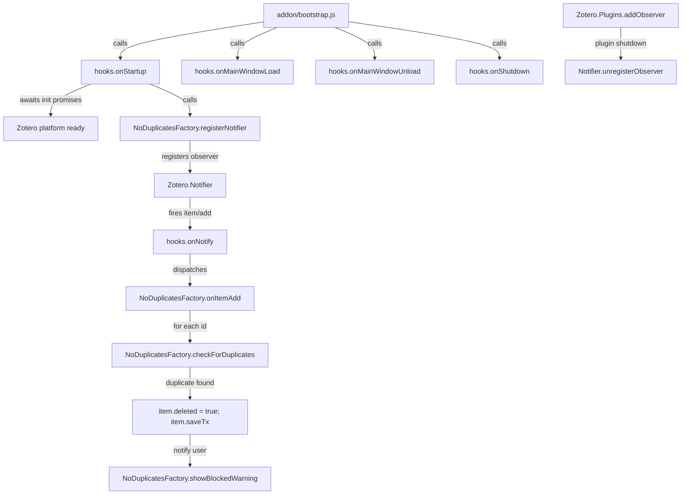
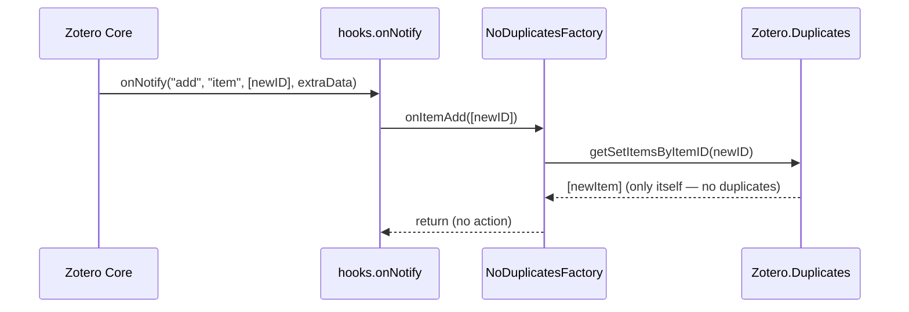

# Design Document: zotero-duplicate-import-blocker

## Overview

The `zotero-duplicate-import-blocker` plugin (package name: **No Duplicates**) silently intercepts every new item added to a Zotero library, checks whether an identical item already exists using Zotero's built-in duplicate-detection engine, and — if a duplicate is detected — moves the newly added item to the trash before the user ever sees it. A brief, non-intrusive progress-window toast informs the user what was blocked and what the surviving item is.

The plugin is built on the official [windingwind Zotero Plugin Template](https://github.com/windingwind/zotero-plugin-template). It wires into the template's established `hooks.ts → NoDuplicatesFactory` static-factory pattern; no bespoke lifecycle classes are introduced.

---

## Architecture

### Overall plugin structure



### File layout after implementation

```
zotero-plugin-noduplicates/
├── package.json                     ← addonName/ID/Ref/Instance updated
├── src/
│   ├── index.ts                     ← unchanged (creates Addon singleton)
│   ├── addon.ts                     ← unchanged (Addon class + data shape)
│   ├── hooks.ts                     ← trimmed: only NoDuplicates wiring
│   ├── modules/
│   │   └── noDuplicates.ts          ← NEW: NoDuplicatesFactory
│   └── utils/
│       └── ztoolkit.ts              ← unchanged
└── .kiro/specs/zotero-duplicate-import-blocker/
    ├── .config.kiro
    └── design.md
```

---

## Sequence Diagrams

### Item-add happy path (duplicate detected)

```mermaid
sequenceDiagram
    participant Z as Zotero Core
    participant N as Zotero.Notifier
    participant H as hooks.onNotify
    participant F as NoDuplicatesFactory
    participant D as Zotero.Duplicates
    participant PW as ztoolkit.ProgressWindow

    Z->>N: notify("add", "item", [newID], extraData)
    N->>H: onNotify("add", "item", [newID], extraData)
    H->>F: onItemAdd([newID])
    F->>Z: Zotero.Items.getAsync(newID)
    Z-->>F: item
    F->>F: isRegularItem() && !inTrash?
    F->>D: new Zotero.Duplicates(libraryID)
    D-->>F: duplicatesObj
    F->>D: duplicatesObj._findDuplicates()
    F->>D: duplicatesObj.getSetItemsByItemID(newID)
    D-->>F: [newItem, existingItem, ...]
    F->>Z: item.deleted = true; await item.saveTx()
    F->>PW: showBlockedWarning(newTitle, existingID, existingTitle)
    PW-->>Z: toast displayed
```

### Item-add no-op path (no duplicate)



---

## Components and Interfaces

### `NoDuplicatesFactory` (`src/modules/noDuplicates.ts`)

**Purpose**: Houses all duplicate-blocking logic as a static factory class, following the template's `BasicExampleFactory` pattern.

**Interface**:

```typescript
export class NoDuplicatesFactory {
  /** Registers a Zotero.Notifier observer for "item" events and schedules
   *  its cleanup via Zotero.Plugins.addObserver on plugin shutdown. */
  static registerNotifier(): void;

  /** Called from hooks.onNotify when event === "add" && type === "item".
   *  Iterates over ids and initiates duplicate checking for each. */
  static async onItemAdd(ids: number[] | string[]): Promise<void>;

  /** Resolves the item, instantiates Zotero.Duplicates for its library,
   *  and returns the full duplicate set (including the new item itself).
   *  Returns null when Zotero.Duplicates is unavailable or item is not
   *  a regular, non-trashed item. */
  static async checkForDuplicates(
    itemID: number,
  ): Promise<Zotero.Item[] | null>;

  /** Moves item to trash (sets deleted flag and persists). */
  static async trashItem(item: Zotero.Item): Promise<void>;

  /** Displays a ProgressWindow toast describing what was blocked. */
  static showBlockedWarning(
    blockedTitle: string,
    existingItemID: number,
    existingTitle: string,
  ): void;

  /** Unregisters the Zotero.Notifier observer. Called automatically
   *  on plugin shutdown via Zotero.Plugins.addObserver. */
  private static unregisterNotifier(notifierID: string): void;
}
```

**Responsibilities**:
- Registers and unregisters the Zotero.Notifier observer
- Filters out notes, attachments, feed items, and already-trashed items
- Delegates to `Zotero.Duplicates` for similarity computation
- Moves the newly added item to trash when a pre-existing duplicate is found
- Displays a non-intrusive toast via `ztoolkit.ProgressWindow`
- Handles graceful degradation when `Zotero.Duplicates` is unavailable

---

### `hooks.ts` (modified)

**Changes from template**:
- Removes all `UIExampleFactory`, `KeyExampleFactory`, `PromptExampleFactory`, `HelperExampleFactory` registrations from `onStartup` and `onMainWindowLoad`
- Removes `registerPrefs()` call
- Imports and calls `NoDuplicatesFactory.registerNotifier()` in `onStartup`
- Adds `if (event === "add" && type === "item")` branch in `onNotify` dispatching to `NoDuplicatesFactory.onItemAdd(ids)`

**Minimal `onStartup`**:

```typescript
async function onStartup() {
  await Promise.all([
    Zotero.initializationPromise,
    Zotero.unlockPromise,
    Zotero.uiReadyPromise,
  ]);

  NoDuplicatesFactory.registerNotifier();

  await Promise.all(
    Zotero.getMainWindows().map((win) => onMainWindowLoad(win)),
  );

  addon.data.initialized = true;
}
```

**Minimal `onMainWindowLoad`**:

```typescript
async function onMainWindowLoad(win: _ZoteroTypes.MainWindow): Promise<void> {
  addon.data.ztoolkit = createZToolkit();
}
```

**`onNotify` with duplicate-blocking dispatch**:

```typescript
async function onNotify(
  event: string,
  type: string,
  ids: Array<string | number>,
  extraData: { [key: string]: any },
) {
  ztoolkit.log("notify", event, type, ids, extraData);
  if (event === "add" && type === "item") {
    await NoDuplicatesFactory.onItemAdd(ids);
  }
}
```

---

### `package.json` config block (updated values)

```json
"config": {
  "addonName": "No Duplicates",
  "addonID": "noduplicates@plugin.zotero",
  "addonRef": "noduplicates",
  "addonInstance": "NoDuplicates",
  "prefsPrefix": "extensions.zotero.noduplicates"
}
```

---

## Data Models

### `DuplicateCheckResult`

Not a standalone type — the result of `checkForDuplicates` is `Zotero.Item[] | null`:

| Value | Meaning |
|---|---|
| `null` | Item is not eligible (note/attachment/trashed) or `Zotero.Duplicates` unavailable |
| Array with length `<= 1` | No duplicates; only the item itself (or empty) |
| Array with length `>= 2` | Duplicate set found; index 0 is NOT guaranteed to be the new item |

### Eligibility filter

An item passes the eligibility filter when **all** of the following hold:

```typescript
item.isRegularItem()        // not a note or attachment
&& !item.deleted            // not already in trash
&& !item.isFeedItem         // not a feed item (RSS)
&& item.libraryID !== null  // belongs to a library
```

---

## Algorithmic Pseudocode

### `registerNotifier()`

```pascal
PROCEDURE NoDuplicatesFactory.registerNotifier()
  SEQUENCE
    callback ← {
      notify: ASYNC PROCEDURE(event, type, ids, extraData)
        IF NOT addon.data.alive THEN
          NoDuplicatesFactory.unregisterNotifier(notifierID)
          RETURN
        END IF
        addon.hooks.onNotify(event, type, ids, extraData)
      END PROCEDURE
    }

    notifierID ← Zotero.Notifier.registerObserver(callback, ["item"])

    Zotero.Plugins.addObserver({
      shutdown: PROCEDURE({ id })
        IF id EQUALS addon.data.config.addonID THEN
          NoDuplicatesFactory.unregisterNotifier(notifierID)
        END IF
      END PROCEDURE
    })
  END SEQUENCE
END PROCEDURE
```

**Preconditions:**
- `addon.data.alive` is `true`
- `addon.data.config.addonID` is a non-empty string

**Postconditions:**
- A notifier observer is registered with `Zotero.Notifier` for `["item"]` events
- A shutdown observer is registered that will clean up the notifier when the plugin stops

---

### `onItemAdd(ids)`

```pascal
PROCEDURE NoDuplicatesFactory.onItemAdd(ids)
  INPUT: ids — array of item IDs (number | string) from notifier event
  OUTPUT: none (side effects: items may be trashed, toast may be shown)

  FOR EACH id IN ids DO
    duplicates ← AWAIT NoDuplicatesFactory.checkForDuplicates(id)

    IF duplicates IS NULL THEN
      CONTINUE  // ineligible item or Zotero.Duplicates unavailable
    END IF

    IF LENGTH(duplicates) <= 1 THEN
      CONTINUE  // no duplicate found — leave item untouched
    END IF

    // Find the pre-existing item (the one that is NOT the new id)
    newItem ← Zotero.Items.get(id)
    existingItem ← FIRST item IN duplicates WHERE item.id NOT EQUALS id

    IF existingItem IS NULL THEN
      CONTINUE  // defensive: all set members are the new item (shouldn't happen)
    END IF

    AWAIT NoDuplicatesFactory.trashItem(newItem)

    NoDuplicatesFactory.showBlockedWarning(
      newItem.getField("title"),
      existingItem.id,
      existingItem.getField("title")
    )
  END FOR
END PROCEDURE
```

**Preconditions:**
- `ids` is a non-empty array (notifier guarantees this)
- `addon.data.alive` is `true`

**Postconditions:**
- For each id that has a duplicate: the corresponding item has `deleted === true` and has been persisted via `saveTx()`
- For each id that has a duplicate: a toast has been displayed
- Items without duplicates are untouched
- Errors for individual items are caught and logged; they do not abort processing of remaining ids

**Loop invariant**: After each iteration, all previously processed items that had duplicates have been trashed and notified; no un-processed item has been modified.

---

### `checkForDuplicates(itemID)`

```pascal
FUNCTION NoDuplicatesFactory.checkForDuplicates(itemID)
  INPUT: itemID — integer item ID
  OUTPUT: Zotero.Item[] or NULL

  item ← AWAIT Zotero.Items.getAsync(itemID)

  IF item IS NULL THEN
    RETURN NULL
  END IF

  IF NOT item.isRegularItem() THEN
    RETURN NULL
  END IF

  IF item.deleted THEN
    RETURN NULL
  END IF

  IF item.isFeedItem THEN
    RETURN NULL
  END IF

  IF NOT Zotero.Duplicates EXISTS THEN
    ztoolkit.log("Zotero.Duplicates unavailable — skipping check")
    RETURN NULL
  END IF

  TRY
    duplicatesObj ← NEW Zotero.Duplicates(item.libraryID)
    AWAIT duplicatesObj._findDuplicates()
    duplicateSet ← duplicatesObj.getSetItemsByItemID(itemID)
    RETURN duplicateSet
  CATCH error
    ztoolkit.log("checkForDuplicates error:", error)
    RETURN NULL
  END TRY
END FUNCTION
```

**Preconditions:**
- `itemID` is a positive integer that exists in the Zotero database

**Postconditions:**
- Returns `null` when item is ineligible or `Zotero.Duplicates` is unavailable
- Returns an array (possibly empty or length 1) when no duplicate found
- Returns an array of length >= 2 when duplicates exist
- No mutations to any Zotero item

---

### `trashItem(item)`

```pascal
PROCEDURE NoDuplicatesFactory.trashItem(item)
  INPUT: item — a Zotero.Item that has passed eligibility checks
  OUTPUT: none (side effect: item is moved to trash in the database)

  item.deleted ← true
  AWAIT item.saveTx()
END PROCEDURE
```

**Preconditions:**
- `item` is a regular, non-deleted Zotero item
- Zotero database is accessible

**Postconditions:**
- `item.deleted === true`
- Change persisted to Zotero database (item visible in trash, not permanently deleted)

---

### `showBlockedWarning(blockedTitle, existingItemID, existingTitle)`

```pascal
PROCEDURE NoDuplicatesFactory.showBlockedWarning(blockedTitle, existingItemID, existingTitle)
  INPUT:
    blockedTitle   — string title of the blocked (trashed) item
    existingItemID — integer ID of the surviving duplicate
    existingTitle  — string title of the surviving duplicate

  NEW ztoolkit.ProgressWindow(addon.data.config.addonName)
    .createLine({
      text: "Duplicate blocked: \"" + blockedTitle + "\"",
      type: "default",
      progress: 100
    })
    .createLine({
      text: "Existing item: \"" + existingTitle + "\"",
      type: "success",
      progress: 100
    })
    .show()
END PROCEDURE
```

**Preconditions:**
- `ztoolkit` global is initialised (guaranteed after `onMainWindowLoad`)
- `blockedTitle` and `existingTitle` are strings (may be empty if item has no title)

**Postconditions:**
- A ProgressWindow toast is displayed in the Zotero main window
- The toast closes automatically after the default timer (no user action required)

---

## Error Handling

### Scenario 1: `Zotero.Duplicates` API unavailable

**Condition**: Future Zotero version removes or renames `Zotero.Duplicates`.  
**Response**: `checkForDuplicates` returns `null` after logging a warning via `ztoolkit.log`.  
**Recovery**: Item is left untouched; plugin continues running without blocking imports.

---

### Scenario 2: Item deleted between notifier fire and processing

**Condition**: Item is deleted externally (e.g., undo operation) between the notifier firing and `checkForDuplicates` executing.  
**Response**: `item.deleted` check in `checkForDuplicates` returns `null`.  
**Recovery**: No action taken; safe no-op.

---

### Scenario 3: `_findDuplicates()` or `getSetItemsByItemID()` throws

**Condition**: Internal Zotero error during duplicate search (e.g., malformed item fields, database lock).  
**Response**: `try/catch` in `checkForDuplicates` logs the error and returns `null`.  
**Recovery**: Item is left untouched; subsequent IDs in the batch continue processing.

---

### Scenario 4: `item.saveTx()` throws during trash operation

**Condition**: Database write fails (e.g., library locked by sync).  
**Response**: Error propagates up from `trashItem`; caught by `onItemAdd`'s per-item try/catch.  
**Recovery**: Item remains un-trashed; toast is not shown; next item in batch is still processed.

---

### Scenario 5: Item is a note, attachment, or feed item

**Condition**: Notifier fires for non-regular-item types (file attachments, notes, RSS entries).  
**Response**: Eligibility filter in `checkForDuplicates` returns `null` immediately.  
**Recovery**: Item is untouched; no performance overhead from duplicate search.

---

### Scenario 6: Plugin is shutting down during item processing

**Condition**: `addon.data.alive` is `false` when notifier callback fires.  
**Response**: The notifier callback checks `addon.data.alive` first and unregisters itself.  
**Recovery**: Pending items are not processed; clean shutdown.

---

## Correctness Properties

The following properties must hold for all valid inputs:

1. **No data loss**: For any item that is moved to trash, `item.deleted === true` and the item is recoverable from the Zotero trash. No item is permanently deleted.

2. **Idempotency of trash**: If `onItemAdd` is called with an id whose item already has `deleted === true`, the eligibility filter returns `null` and no further action is taken.

3. **Non-interference with non-duplicates**: For any item `i` where `checkForDuplicates(i.id)` returns an array of length <= 1, `i.deleted` remains `false` and `i` is not modified.

4. **At-most-one survivor per duplicate set**: After `onItemAdd` processes a batch containing a duplicate, exactly one item from the duplicate pair survives (the pre-existing one). The newly added item is trashed.

5. **Notifier cleanup**: When the plugin shuts down, `Zotero.Notifier.unregisterObserver(notifierID)` is called exactly once. No orphaned observers remain.

6. **No blocking of regular item types**: Notes (`item.isNote()`), attachments (`item.isAttachment()`), and feed items (`item.isFeedItem`) are never trashed by this plugin.

7. **Graceful degradation**: If `Zotero.Duplicates` is not available (e.g., API change in a future Zotero version), no items are trashed and no errors are surfaced to the user.

---

## Testing Strategy

The project uses `zotero-plugin-scaffold` with mocha/chai for integration tests running against a real Zotero instance.

### Unit Testing Approach

Each static method of `NoDuplicatesFactory` should have isolated tests:

- `checkForDuplicates` with mocked `Zotero.Items.getAsync` returning: note items, attachment items, trashed items, regular items with no duplicates, regular items with duplicates
- `trashItem` verifies `item.deleted === true` is set and `saveTx()` is called
- `showBlockedWarning` verifies `ztoolkit.ProgressWindow` is constructed with expected text

### Property-Based Testing Approach

**Property Test Library**: mocha + chai (project's existing stack; no additional library needed)

Key properties to verify:

```typescript
// Property 1: eligibility filter excludes all non-regular items
for all items where !item.isRegularItem():
  checkForDuplicates(item.id) returns null

// Property 2: items already in trash are never trashed again
for all items where item.deleted === true:
  onItemAdd([item.id]) leaves item.deleted === true (no double-save)

// Property 3: items not in a duplicate set are never modified
for all items where getSetItemsByItemID returns array.length <= 1:
  item.deleted remains false after onItemAdd

// Property 4: only the newly added item is trashed, not the existing one
for all duplicate pairs (newItem, existingItem):
  after onItemAdd([newItem.id]):
    newItem.deleted === true
    existingItem.deleted === false
```

### Integration Testing Approach

Tests run against a live Zotero instance using `zotero-plugin-scaffold`:

1. **Test: clean import** — import a unique item; verify it is NOT trashed
2. **Test: duplicate import** — import an item identical to one already in the library; verify the new item is trashed and the original survives
3. **Test: bulk import with mixed items** — import 3 items (1 unique, 2 duplicates of existing); verify only the 2 duplicates are trashed
4. **Test: note/attachment passthrough** — add a note/attachment; verify it is never trashed
5. **Test: shutdown cleanup** — trigger plugin shutdown; verify `Zotero.Notifier` has no orphaned observer from this plugin

---

## Performance Considerations

- `Zotero.Duplicates._findDuplicates()` performs a full duplicate scan of the library on each call. For large libraries (> 10,000 items) this may add noticeable latency to each import. Consider caching or batching if this becomes a user-reported concern.
- The notifier fires for every item add, including programmatic bulk imports. `onItemAdd` processes IDs sequentially with `await`; for large batches (e.g., importing 100 PDFs at once), this may queue up. If performance issues arise, the loop can be parallelised with `Promise.all` (with care around write contention on `saveTx`).
- All operations are async and non-blocking; they do not freeze the Zotero UI.

---

## Security Considerations

- The plugin only reads item metadata and writes `item.deleted = true`. It does not access the filesystem, network, or any external service.
- No user credentials or sensitive data are processed.
- The plugin operates entirely within the Zotero sandbox environment.

---

## Dependencies

| Package | Version | Role |
|---|---|---|
| `zotero-plugin-toolkit` | `^5.1.0-beta.13` | `ztoolkit.ProgressWindow`, `ZoteroToolkit` |
| `zotero-types` | `^4.1.0-beta.4` | TypeScript type definitions for Zotero APIs |
| `zotero-plugin-scaffold` | `^0.8.2` | Build, serve, test tooling |
| `mocha` | `^11.7.5` | Test runner |
| `chai` | `^6.2.1` | Assertion library |

All dependencies are already present in `package.json`. No new dependencies are required.
